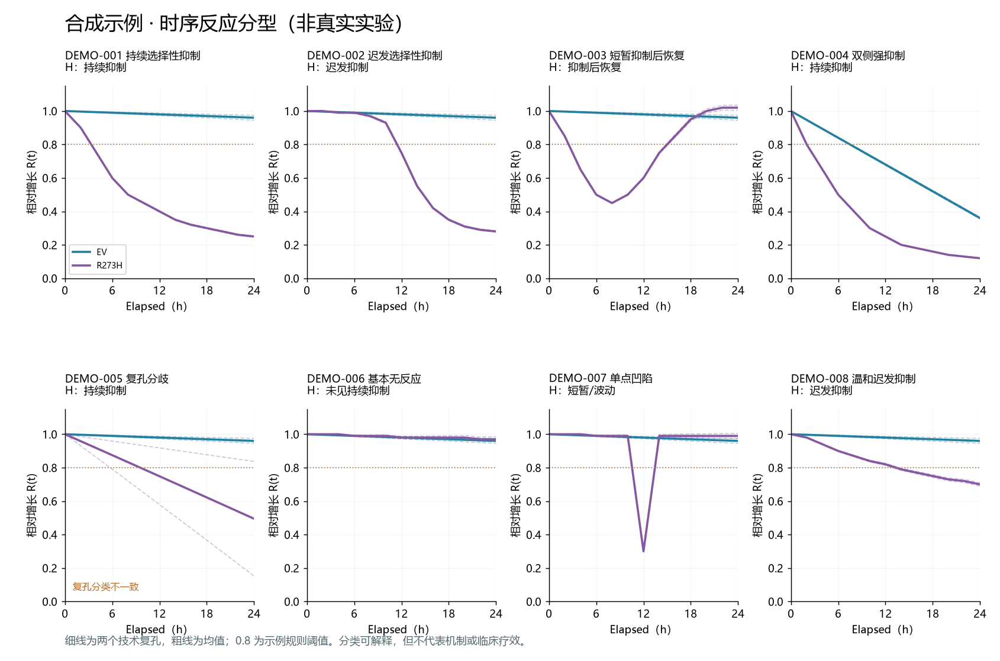

# DrugScreen Workbench

**Local, interpretable time-course drug screening for paired EV / R273H cell models.**

A Python/Tk desktop workbench for 96-well count matrices: plate review, reversible experiment history, descriptive drug-response metrics, inhibition scatter plots, directional waterfall rankings, temporal response classification, rank sensitivity analysis and versioned rescreen records.

The interface is currently Chinese. This repository contains code and a deterministic synthetic-data generator. It contains no private experimental measurements, compound-library plate maps or experiment databases.



*Preview uses generated, fictional data only.*

## Quick start

Python 3.12 with Tk is the tested runtime. On Windows, install Python with Tcl/Tk support. On Linux, Tk and a graphical display are required; a CJK font is needed for Chinese chart labels.

```sh
git clone https://github.com/PUMC-Max/drugscreen-workbench.git
cd drugscreen-workbench
python -m venv .venv
# Windows PowerShell:
.venv\Scripts\Activate.ps1
# macOS/Linux instead: source .venv/bin/activate
python -m pip install -r requirements.txt
python launch.py
```

The first launch generates eight fictional treatments, two plates and 13 timepoints, then opens the complete workbench. All synthetic rescreen labels are marked as simulated. Subsequent launches preserve local edits. The demo and formal databases are separate.

## Features

- Review a 96-well layout before saving or replacing a TXT readout.
- Preserve raw counts, layout snapshots, superseded experiments and database backups.
- Analyze separate EV/H plates or both cell types on one physical plate, each with its own DMSO controls.
- Pool all paired records for scatter and waterfall plots, retaining the plate-pair identity rather than silently merging the same treatment across plates.
- Compare GI, count inhibition, GR-derived inhibition and time-averaged inhibition; inspect heatmaps and replicate trajectories.
- Flag unusual trajectories and control behavior without automatically excluding data or masking calculable results.
- Classify temporal responses with editable, explicit rules.
- Compare ranks across metric, threshold, weight and technical-replicate choices.
- Append manual rescreen outcomes with evidence references and source-change warnings.
- Export figures with plotting data and analysis parameters.

## Your own data

For a formal workspace:

```sh
python launch.py --layout YOUR_LAYOUT.xlsx
python launch.py --formal
```

The app accepts the Chinese layout schema handled by `templates.py`, or a `PlateMap` worksheet with `plate_id`, `well`, `cell_line`, `treatment`, `replicate`, `treatment_class`, and `dmso_reference`. See [input formats](docs/INPUT_FORMATS.md).

The readout TXT must contain exactly 13 complete 96-well matrices at Elapsed 0, 2, ..., 24 hours. Missing timepoints are rejected rather than silently imputed. Elapsed 0 is the acquisition baseline. Counts are per-image averages; the app does not extract cells from microscopy images.

An optional isolated file example can be opened with:

```sh
python file_example.py --map YOUR_LAYOUT.xlsx --counts YOUR_COUNTS.txt --out example/my-data --open
```

## What the scores mean

The default model is a single screening concentration of 5 μM and two technical replicates per cell type. RSL3 defaults to 1 μM. Unspecified reference-treatment concentrations stay unspecified.

- **V**: endpoint count divided by the same-cell DMSO median. **1−V** is relative count inhibition.
- **GI**: `1−(f−1)/(c−1)`, where `f=N24/N0` and `c` is the median DMSO fold change. GI=1 means no net count growth.
- **GR**: `2**(log(f)/log(c))−1`. GR=0 means no net count growth; negative values mean counts fell below baseline. GI/GR require growing controls and valid baselines.
- **TI**: `1−integral(V(t), 0..24)/24`, a time average, not concentration-response AUC.
- **Z / robust Z**: departure from same-cell DMSO controls, not a probability or inhibition percentage. Few controls make these estimates unstable.
- **Selectivity**: a difference between the two cell types. Strong selectivity does not itself imply strong absolute inhibition.
- **Composite score**: `100*clip(1−V_H)**w*clip(V_EV)**(1−w)`, default `w=0.5`. This is a user-preference score for H count inhibition and EV count preservation. It is **not an ensemble of nine methods**, a validated biological endpoint or a success probability.

Counts alone do not establish cell death, mechanism or mutation-specific targeting. Technical replicates and repeated images are not independent experiments. This design does not support IC50/GR50 fitting, confirmatory equivalence tests or independent-experiment p-values/FDR. Rank stability is sensitivity to analysis settings, not biological reproducibility. Temporal classes are rules, not a trained AI model.

References: [Hafner et al., GR metrics](https://pmc.ncbi.nlm.nih.gov/articles/PMC4887336/), [Assay Guidance Manual](https://www.ncbi.nlm.nih.gov/books/NBK126174/).

## Tests

```sh
python -m unittest discover -s . -p "test_*.py" -v
```

Tests cover parsing, normalization, cell-specific controls, directional scores, immutable source data, replacement/removal, historical provenance and Tk chart interactions. GUI tests need a display. On a headless Linux runner use `xvfb-run -a python -m unittest discover -s . -p "test_*.py"`.

## 中文说明

这是用于 EV/R273H 连续计数药筛的本地桌面工作台。运行 `python launch.py` 即可打开完整合成示例。真实数据由用户在本机导入，不随仓库发布。

散点图突出抑制倾向，瀑布图展示抑制差排名。异常仅提示，不自动剔除。综合分仅表示“H抑制—EV保留”的排序偏好；时序分型和排名稳定性都是探索性分析。复筛结论由人工录入并保留版本，当前没有训练AI预测模型。

## Contributing and license

See [CONTRIBUTING.md](CONTRIBUTING.md). Code is released under the [MIT License](LICENSE). Dependency licenses remain with their respective authors; dependencies are installed separately rather than vendored here.
